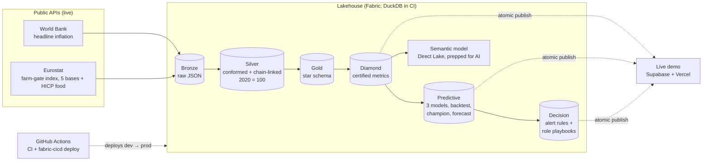

# Food Price Transmission — a Lakehouse on Microsoft Fabric

> **Status: 🚧 work in progress.** Ingestion, silver, gold, Diamond, the predictive and the decision layers run on live Eurostat and World Bank data, are tested in CI and publish to a **[live demo](https://food-price-transmission-dashboard.vercel.app)**. The Direct Lake semantic model is generated as code; Fabric deployment is next.

## The question

**How long does a shock in farm-gate (producer) prices take to reach consumer food prices, in which European countries does it pass through the most, what comes next year, and what should each team do about it?**

A fictional European food cooperative wants to know where margin pressure will hit next. The business case is the vehicle; the point of this repo is the **architecture**.

## Architecture at a glance



See [architecture](docs/architecture.md), [data model](docs/data-model.md), [metric catalogue](docs/metrics.md), [semantic model](docs/semantic-model.md), [decision layer](docs/decisions.md) and [governance](docs/governance.md).

## Decisions

| ADR | Decision | Status |
|---|---|---|
| [0001](docs/adr/0001-platform-choice.md) | Data platform: Microsoft Fabric vs Databricks vs Snowflake | Accepted |
| [0002](docs/adr/0002-cicd-github-actions.md) | CI/CD: GitHub Actions + fabric-cicd vs Azure DevOps | Accepted |
| [0003](docs/adr/0003-portable-sql-transformations.md) | Transformations: portable SQL tested on DuckDB vs PySpark vs dbt | Accepted |
| [0004](docs/adr/0004-eurostat-instead-of-faostat.md) | Source: Eurostat instead of FAOSTAT (unreachable from cloud) | Accepted |
| [0005](docs/adr/0005-load-strategy-window-merge.md) | Load: rolling window + MERGE by default, per-source override | Accepted |
| [0006](docs/adr/0006-diamond-metrics-layer.md) | Diamond: metric catalogue generating materialised tables | Accepted |
| [0007](docs/adr/0007-governance-as-data-product.md) | Governance as code, structured as a data product | Accepted |
| [0008](docs/adr/0008-public-demo-supabase-vercel.md) | Public demo: Supabase + Vercel | Accepted |
| [0009](docs/adr/0009-where-predictions-and-alerts-run.md) | Forecasts and alerts computed in the pipeline; browser applies published coefficients, guarded by a parity test | Accepted |
| [0010](docs/adr/0010-chain-linked-price-indices.md) | Chain-link the five Eurostat index bases and rebase to 2020 = 100 | Accepted |
| [0011](docs/adr/0011-model-selection-champion-challenger.md) | Three models, rolling-origin backtest, simplest champion within tolerance | Accepted |
| [0012](docs/adr/0012-decision-layer.md) | Alert rules as code and playbooks per technical role | Accepted |
| [0013](docs/adr/0013-direct-lake-semantic-model.md) | Semantic model: Direct Lake on OneLake, generated as TMDL from the metric catalogue | Proposed |

## What the predictive layer found

On 424 out-of-sample forecasts (2010-2025), the regression and gradient boosting cut the naive baseline's error by 22% (MAE 2.4 vs 3.1 pp). They tie, so the **simpler, explainable regression is champion** ([ADR 0011](docs/adr/0011-model-selection-champion-challenger.md)). About a quarter of a farm-gate price change reaches consumer food prices the following year.

## Cost

Every process and tool is costed across three scenarios — **Demo**, **SME** and **Enterprise** — from a versioned model in [`cost/`](cost/). See [docs/cost.md](docs/cost.md). Prices are shown as ranges with their source and the date they were checked; unverified prices are flagged, never guessed.

## Repository layout

```
docs/          architecture, ADRs, cost report
ingestion/     public API clients, source registry and load plans
transform/     portable SQL for silver and gold, seeds, local DuckDB runner
quality/       data contracts per layer, checked as each table is built
metrics/       metric catalogue that generates the Diamond table and docs
semantic/      semantic model spec and the generator of TMDL, DAX measures and data agent instructions
fabric/        generated Fabric items (Direct Lake semantic model) and data agent instructions
ml/            model catalogue, backtest, champion selection and forecast
decisions/     alert rules and role playbooks that generate the alert SQL and docs
publish/       atomic publisher to the public demo (keyed + snapshot tables)
serving/       versioned Supabase schema for the public demo
governance/    data product descriptor and lineage generator
infra/         Fabric workspace + fabric-cicd configuration
cost/          cost model (YAML) and the script that renders docs/cost.md
tests/         unit tests
```

## Run it locally

```bash
pip install -e ".[dev]"
pytest

# full run on live data: ingestion -> silver -> gold -> Diamond -> forecasts -> alerts (DuckDB)
python -m transform.pipeline --out data/gold

# regenerate code and docs from the catalogues (CI fails if they are stale)
python -m metrics.build && python -m semantic.build && python -m decisions.build && python -m governance.build && python -m cost.render
```

## Data sources and licences

| Source | Licence |
|---|---|
| [World Bank Indicators API](https://datahelpdesk.worldbank.org/knowledgebase/articles/889392-about-the-indicators-api) | CC BY 4.0 |
| [Eurostat](https://ec.europa.eu/eurostat/web/user-guides/data-browser/api-data-access/api-getting-started) | Eurostat reuse policy (attribution) |

No data is committed to this repo: it is pulled from the APIs on every run.

**Upstream availability.** A weekly CI job calls each API for real and blocks the build if one is down. FAOSTAT was the original source and was replaced because it was unreachable from cloud runners ([ADR 0004](docs/adr/0004-eurostat-instead-of-faostat.md)).

---

Designed and built by [Alejandro Caldentey](https://github.com/alejandrocaldentey).
