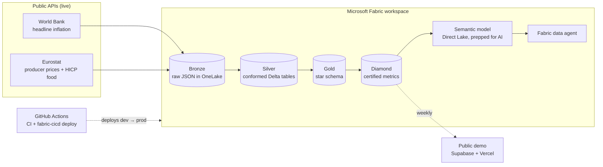

# Food Price Transmission — a Lakehouse on Microsoft Fabric

> **Status: 🚧 work in progress.** Ingestion, silver, gold and Diamond run on live Eurostat and World Bank data and are tested in CI; Fabric deployment and the public demo are next.

## The question

**How long does a shock in farm-gate (producer) prices take to reach consumer food prices — and in which European countries does it pass through the most?**

A fictional European food cooperative wants to know where margin pressure will hit next. The business case is the vehicle; the point of this repo is the **architecture**.

## Architecture at a glance



See [architecture](docs/architecture.md), [data model](docs/data-model.md), [metric catalogue](docs/metrics.md) and [governance](docs/governance.md).

## Decisions

| ADR | Decision | Status |
|---|---|---|
| [0001](docs/adr/0001-platform-choice.md) | Data platform: Microsoft Fabric vs Databricks vs Snowflake | Accepted |
| [0002](docs/adr/0002-cicd-github-actions.md) | CI/CD: GitHub Actions + fabric-cicd vs Azure DevOps | Accepted |
| [0003](docs/adr/0003-portable-sql-transformations.md) | Transformations: portable SQL tested on DuckDB vs PySpark vs dbt | Accepted |
| [0004](docs/adr/0004-eurostat-instead-of-faostat.md) | Source: Eurostat instead of FAOSTAT (unreachable from cloud) | Accepted |
| [0005](docs/adr/0005-load-strategy-window-merge.md) | Load: rolling window + MERGE by default, per-source override | Accepted |
| [0006](docs/adr/0006-diamond-metrics-layer.md) | Diamond: metric catalogue generating materialised tables | Accepted |
| [0007](docs/adr/0007-governance-as-data-product.md) | Governance as code, structured as a data product | Accepted |
| [0008](docs/adr/0008-public-demo-supabase-vercel.md) | Public demo: Supabase + Vercel | Accepted |

## Cost

Every process and tool is costed across three scenarios — **Demo**, **SME** and **Enterprise** — from a versioned model in [`cost/`](cost/). See [docs/cost.md](docs/cost.md). Prices are shown as ranges with their source and the date they were checked; unverified prices are flagged, never guessed.

## Repository layout

```
docs/          architecture, ADRs, cost report
ingestion/     public API clients, source registry and load plans
transform/     portable SQL for silver and gold, seeds, local DuckDB runner
quality/       data contracts per layer, checked as each table is built
metrics/       metric catalogue that generates the Diamond table and docs
governance/    data product descriptor and lineage generator
infra/         Fabric workspace + fabric-cicd configuration
cost/          cost model (YAML) and the script that renders docs/cost.md
tests/         unit tests
```

## Run it locally

```bash
pip install -e ".[dev]"
pytest

# pull bronze from the live APIs, then build silver and gold on DuckDB
python -m ingestion.worldbank FP.CPI.TOTL.ZG --countries "ESP;FRA;DEU" --dates 2015:2024 > wb.jsonl
python -m ingestion.eurostat apri_pi_outa --filter p_adj=NI --filter unit=I20 --filter am_item=AM140000 --since 2015 > es.jsonl
python -m ingestion.eurostat prc_hicp_aind --filter unit=INX_A_AVG --filter coicop=CP01 --since 2015 >> es.jsonl
python -m transform.run_local --worldbank wb.jsonl --eurostat es.jsonl --out data/gold
```

## Data sources and licences

| Source | Licence |
|---|---|
| [World Bank Indicators API](https://datahelpdesk.worldbank.org/knowledgebase/articles/889392-about-the-indicators-api) | CC BY 4.0 |
| [Eurostat](https://ec.europa.eu/eurostat/web/user-guides/data-browser/api-data-access/api-getting-started) | Eurostat reuse policy (attribution) |

No data is committed to this repo: it is pulled from the APIs on every run.

**Upstream availability.** A weekly CI job calls each API for real and blocks the build if one is down. FAOSTAT was the original source and was replaced because it was unreachable from cloud runners ([ADR 0004](docs/adr/0004-eurostat-instead-of-faostat.md)).

---

Architecture, decisions and review by [Alejandro Caldentey](https://github.com/alejandrocaldentey). Built with AI assistance.
