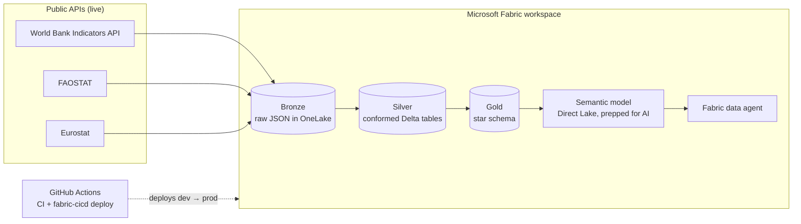

# Food Price Transmission — a Lakehouse on Microsoft Fabric

> **Status: 🚧 work in progress.** Ingestion, silver and gold run and are tested locally; Fabric deployment is next.

## The question

**How long does a shock in farm-gate (producer) prices take to reach consumer food prices — and in which countries does it pass through the most?**

A fictional European food cooperative wants to know where margin pressure will hit next. The business case is the vehicle; the point of this repo is the **architecture**.

## Architecture at a glance



See [docs/architecture.md](docs/architecture.md) for the full data flow and [docs/data-model.md](docs/data-model.md) for the silver and gold model.

## Decisions

| ADR | Decision | Status |
|---|---|---|
| [0001](docs/adr/0001-platform-choice.md) | Data platform: Microsoft Fabric vs Databricks vs Snowflake | Accepted |
| [0002](docs/adr/0002-cicd-github-actions.md) | CI/CD: GitHub Actions + fabric-cicd vs Azure DevOps | Accepted |
| [0003](docs/adr/0003-portable-sql-transformations.md) | Transformations: portable SQL tested on DuckDB vs PySpark vs dbt | Accepted |

## Cost

Every process and tool is costed across three scenarios — **Demo**, **SME** and **Enterprise** — from a versioned model in [`cost/`](cost/). See [docs/cost.md](docs/cost.md). Prices are shown as ranges with their source and the date they were checked; unverified prices are flagged, never guessed.

## Repository layout

```
docs/          architecture, ADRs, cost report
ingestion/     public API clients (incremental, with retries)
transform/     portable SQL for silver and gold, seeds, local DuckDB runner
quality/       data contracts, checked before gold is built
infra/         Fabric workspace + fabric-cicd configuration
cost/          cost model (YAML) and the script that renders docs/cost.md
tests/         unit tests
```

## Run it locally

```bash
pip install -e ".[dev]"
pytest

# pull bronze from the live APIs, then build silver and gold on DuckDB
python -m ingestion.worldbank FP.CPI.TOTL.ZG --countries "ESP;FRA;DEU" --dates 2015:2024 > wb.jsonl
python -m ingestion.faostat PP --areas 203 --years 2020,2021,2022 > fao.jsonl
python -m transform.run_local --worldbank wb.jsonl --faostat fao.jsonl --out data/gold
```

## Data sources and licences

| Source | Licence |
|---|---|
| [World Bank Indicators API](https://datahelpdesk.worldbank.org/knowledgebase/articles/889392-about-the-indicators-api) | CC BY 4.0 |
| [FAOSTAT](https://www.fao.org/faostat/) | CC BY 4.0 (check per domain) |
| [Eurostat](https://ec.europa.eu/eurostat/web/user-guides/data-browser/api-data-access/api-getting-started) | Eurostat reuse policy (attribution) |

No data is committed to this repo: it is pulled from the APIs on every run.

**Upstream availability.** A weekly CI job calls each API for real. The World Bank check blocks the build; the FAOSTAT check is non-blocking because its servers sometimes reject cloud runners (HTTP 521). In the pipeline, each source keeps its own watermark, so one source being down never blocks the others.

---

Architecture, decisions and review by [Alejandro Caldentey](https://github.com/alejandrocaldentey). Built with AI assistance.
