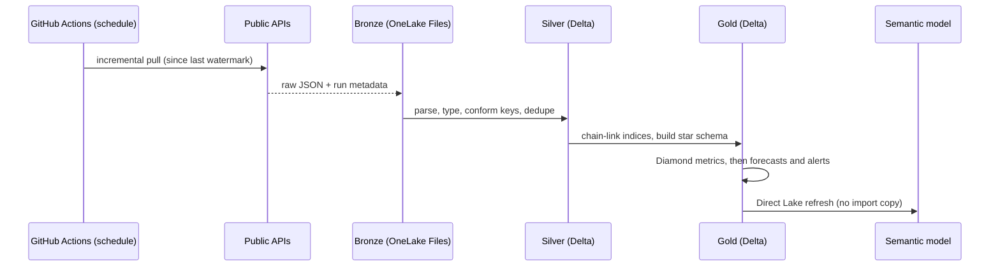

# Architecture

## Layers

| Layer | Where | What lands there | Format |
|---|---|---|---|
| Bronze | OneLake `Files/bronze/<source>/<date>/` | Raw API responses, untouched, with ingestion metadata | JSON |
| Silver | Lakehouse tables `silver_*` | Typed, deduplicated observations; one continuous index per country, chain-linked across Eurostat bases and rebased to 2020 = 100 ([ADR 0010](adr/0010-chain-linked-price-indices.md)) | Delta |
| Gold | Lakehouse tables `gold_*`, `dim_*`, `fact_*` | Star schema and the producer-vs-consumer transmission table | Delta |
| Diamond | `diamond_country_year` | Certified metrics generated from the catalogue ([ADR 0006](adr/0006-diamond-metrics-layer.md)) | Delta |
| Predictive | `ml_*` | Three models, rolling-origin backtest, champion, forecast with 80% interval, published coefficients ([ADR 0011](adr/0011-model-selection-champion-challenger.md)) | Delta |
| Decision | `decision_*` | Alert rules compiled from YAML; role playbooks ([ADR 0012](adr/0012-decision-layer.md)) | Delta |
| Serving | Semantic model (Direct Lake) and the public demo (Supabase + Vercel) | Certified measures, forecasts and alerts; the demo applies published coefficients only ([ADR 0009](adr/0009-where-predictions-and-alerts-run.md)) | — |
| AI | Fabric data agent | Natural-language questions over the semantic model | — |

## Flow

## Design principles

- **Idempotent runs:** re-running a day overwrites that day's bronze partition and merges silver by natural key.
- **Watermarks per source:** each API keeps its own last-loaded period, so one failing source never blocks the others.
- **Contracts at the silver boundary:** schema and quality checks live in [`quality/`](../quality/) and fail the run before gold is touched.
- **Compute where definitions are governed:** forecasts and alerts are tables with contracts, not logic in a report ([ADR 0009](adr/0009-where-predictions-and-alerts-run.md)).
- **Atomic publish:** snapshot tables carry a run id; readers switch to a run only once it is complete.
- **Open formats:** Delta in OneLake keeps the data portable if the platform changes ([ADR 0001](adr/0001-platform-choice.md)).
