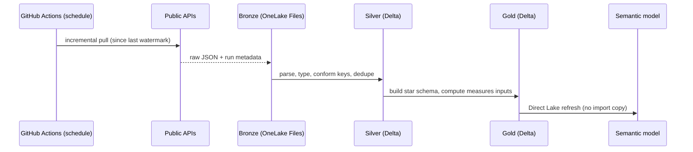

# Architecture

## Layers

| Layer | Where | What lands there | Format |
|---|---|---|---|
| Bronze | OneLake `Files/bronze/<source>/<date>/` | Raw API responses, untouched, with ingestion metadata | JSON |
| Silver | Lakehouse tables `silver_*` | Typed, deduplicated, conformed country and period keys (ISO 3166, monthly/annual) | Delta |
| Gold | Lakehouse tables `gold_*` | Star schema: `fact_price_index`, `dim_country`, `dim_item`, `dim_period` | Delta |
| Serving | Semantic model (Direct Lake) | Certified measures: producer-to-consumer gap, pass-through lag | — |
| AI | Fabric data agent | Natural-language questions over the semantic model | — |

## Flow

## Design principles

- **Idempotent runs:** re-running a day overwrites that day's bronze partition and merges silver by natural key.
- **Watermarks per source:** each API keeps its own last-loaded period, so one failing source never blocks the others.
- **Contracts at the silver boundary:** schema and quality checks live in [`quality/`](../quality/) and fail the run before gold is touched.
- **Open formats:** Delta in OneLake keeps the data portable if the platform changes ([ADR 0001](adr/0001-platform-choice.md)).
