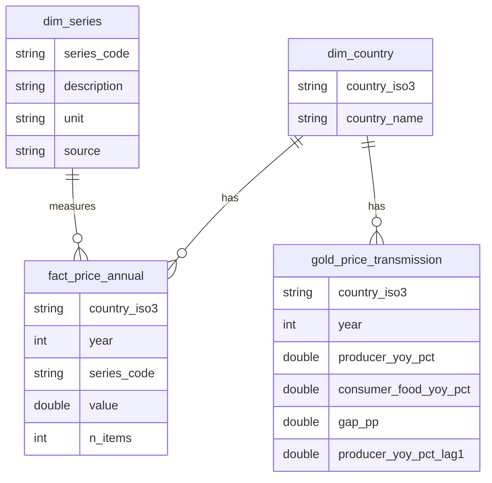

# Data model

The model answers one question: **how much of a change in farm-gate prices shows up in consumer food prices, and with what lag?**

Four layers: **silver** conforms, **gold** models, **Diamond** defines what the numbers mean. Bronze keeps raw API responses (see [architecture](architecture.md)).

## Silver

`silver_price_observation` — one row per source observation, typed and conformed.

| Column | Type | Notes |
|---|---|---|
| source | string | `eurostat` or `worldbank` |
| country_iso3 | string | ISO 3166-1 alpha-3; Eurostat codes converted (EL → GRC, UK → GBR); aggregates such as EU27 dropped |
| year | int | |
| month | int, nullable | null for annual series |
| series_code | string | see `dim_series` |
| item_code | string | `ALL` when the series has no product breakdown |
| item_name | string | source dataset or indicator name |
| value | double | null kept, never dropped |
| unit | string | |
| ingested_at | timestamp | latest wins on duplicates (revisions) |

Natural key: `source, country_iso3, year, month, series_code, item_code`. In Fabric it is MERGEd on this key ([ADR 0005](adr/0005-load-strategy-window-merge.md)).

## Gold (star schema)

- `fact_price_annual` — annual value per country and series; monthly series are averaged to the year.
- `gold_price_transmission` — year-on-year changes side by side, only between consecutive years, plus the producer change lagged one year.

## Diamond (certified metrics)

`diamond_country_year` — one row per country and year, one column per metric in the [metric catalogue](metrics.md). It is **generated** from [`metrics/metrics.yaml`](../metrics/metrics.yaml) and never edited by hand ([ADR 0006](adr/0006-diamond-metrics-layer.md)). This is the table that BI, the public demo and AI agents read.

## Series

| series_code | Source | What it is |
|---|---|---|
| `PRODUCER_PI` | Eurostat `apri_pi_outa` (`am_item=AM140000`, nominal, 2020 = 100) | Price index of agricultural goods incl. fruit and vegetables, output |
| `CONSUMER_FOOD_PI` | Eurostat `prc_hicp_aind` (`coicop=CP01`, annual average index) | HICP — food and non-alcoholic beverages |
| `CPI_INFLATION` | World Bank `FP.CPI.TOTL.ZG` | Consumer price inflation, all items (annual %) |
