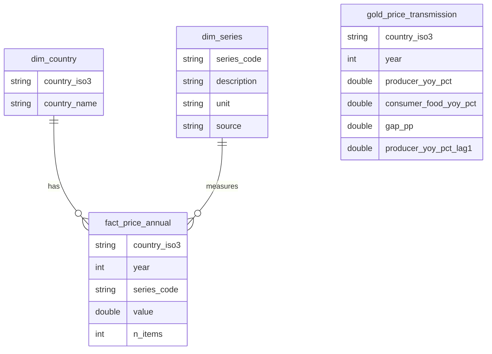

# Data model

The gold layer answers one question: **how much of a change in farm-gate prices shows up in consumer food prices, and with what lag?**

## Silver

`silver_price_observation` — one row per source observation, typed and conformed.

| Column | Type | Notes |
|---|---|---|
| source | string | `worldbank` or `faostat` |
| country_iso3 | string | ISO 3166-1 alpha-3; FAO M49 codes are converted |
| year | int | |
| month | int, nullable | null for annual series |
| series_code | string | see `dim_series` |
| item_code | string | FAO item code; `ALL` when the series has no item |
| item_name | string | |
| value | double | null kept and flagged, never dropped |
| unit | string | |
| ingested_at | timestamp | latest wins on duplicates |

Natural key: `source, country_iso3, year, month, series_code, item_code`.

## Gold (star schema)

- `fact_price_annual` — annual value per country and series. Monthly series are averaged to the year; producer price indices are averaged across items (unweighted — a documented simplification; weighting by production value is a planned refinement).
- `gold_price_transmission` — year-on-year changes side by side, the gap between consumer food and producer prices in percentage points, and the producer change lagged one year, which is the input for pass-through analysis in the semantic model.

## Series

| series_code | Source | What it is |
|---|---|---|
| `PRODUCER_PI` | FAOSTAT `PP` | Agricultural producer price index |
| `CONSUMER_FOOD_PI` | FAOSTAT `CP` | Consumer prices, food indices |
| `CPI_INFLATION` | World Bank `FP.CPI.TOTL.ZG` | Consumer price inflation, all items (annual %) |
