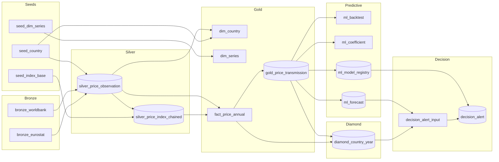

# Governance — Food price transmission in Europe

Generated from [`governance/product.yaml`](../governance/product.yaml), the source registry and the SQL itself by `python -m governance.build`.

## Data product

| Field | Value |
|---|---|
| Name | `food-price-transmission` |
| Domain | Agri-food economics |
| Owner | Alejandro Caldentey |
| Purpose | Show how changes in farm-gate prices reach consumer food prices, forecast next year and turn signals into role-specific actions. |
| Classification | public (personal data: no) |
| Licence | Derived from Eurostat (reuse with attribution) and World Bank (CC BY 4.0) |
| Freshness SLA | weekly |
| Consumers | Power BI semantic model (Fabric, Direct Lake); Public dashboard (Vercel, read-only API on Supabase); Fabric data agent (natural-language questions) |

## Output ports

| Table | Description | Contract |
|---|---|---|
| `diamond_country_year` | Certified metrics, one row per country and year | [quality/contracts/diamond_country_year.yaml](../quality/contracts/diamond_country_year.yaml) |
| `ml_forecast` | Next year's consumer food price change per country and model, with an 80% interval | [quality/contracts/ml_forecast.yaml](../quality/contracts/ml_forecast.yaml) |
| `ml_model_registry` | Catalogued models scored on a rolling-origin backtest, champion flagged | [quality/contracts/ml_model_registry.yaml](../quality/contracts/ml_model_registry.yaml) |
| `decision_alert` | Fired alert rules by country and year, linked to role playbooks | [quality/contracts/decision_alert.yaml](../quality/contracts/decision_alert.yaml) |
| `gold_price_transmission` | Producer vs consumer food price changes, side by side | [quality/contracts/gold_price_transmission.yaml](../quality/contracts/gold_price_transmission.yaml) |

## Sources

| Source | Dataset / indicator | Load strategy |
|---|---|---|
| eurostat | `apri_pi_outa` | window_merge (3 years) |
| eurostat | `prc_hicp_aind` | window_merge (3 years) |
| worldbank | `FP.CPI.TOTL.ZG` | window_merge (3 years) |

## Lineage

Tables drawn as cylinders have a data contract, checked right after they are built.
